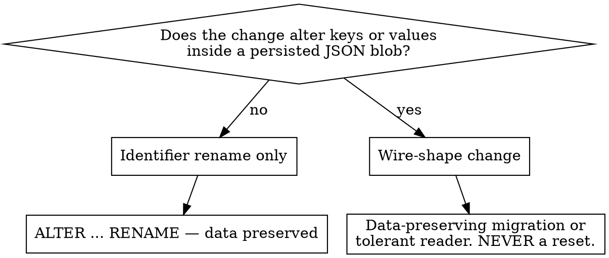

# New migration

## Read these first

- `prisma/schema.prisma` — 5 models: `User`, `Pattern`, `SizeChart`, `Wallet`, `Transaction`. `Pattern` and `SizeChart` are thin rows whose real content is a `data Json` blob; `Wallet` is 1:1 with `User`; `Transaction` is an append-only ledger. Every child FK is `onDelete: Cascade`.
- The 8 existing migration directory names — the history is the lesson:

```
20260816180005_init_user
20260816213053_add_molde
20260817002232_reset_moldes_english        <- wiped every pattern
20260817231004_add_wallet_billing
20260818201820_molde_own_id
20260819120000_rename_molde_to_pattern     <- naming cleanup
20260819130000_add_grades
20260819140000_rename_grade_to_size_chart  <- naming cleanup
```

Three of eight exist only to undo naming and shape mistakes. The next two sections are how not to add a fourth.

## 1. Name it right — before you type the model or column

**TRANSLATE the domain term from the pt-BR design doc into English. Never transliterate it.**

| pt-BR design term | Correct | Shipped first as | Cost |
|---|---|---|---|
| "grades" (Medidas e grades) | `SizeChart` | `Grade` | repo-wide sweep + `rename_grade_to_size_chart` |
| "molde" | `Pattern` | `Molde` | repo-wide sweep + `rename_molde_to_pattern` |

Each sweep touched files, functions, routes, Prisma models/columns, and i18n keys — plus its own migration. `Grade` even reads as a valid English word, which is exactly why it survived review; it means "school grade," not "size chart."

Checklist:

- [ ] Term comes from the pt-BR design doc → translate the *meaning*, don't spell it in English letters.
- [ ] Model/column/enum/route identifier is English. UI display text stays pt-BR and lives in `messages/pt-BR.json`, never in the schema.
- [ ] Search the codebase for the English word you picked — if a different English word is already used for the same concept, match it.
- [ ] Migration directory name: snake_case, English, verb-first — `add_*`, `rename_<old>_to_<new>`, `<model>_<change>`.

## 2. The decision that matters — identifier rename, or blob-shape change?

Make this call **before writing any SQL**.



**Identifier rename (cheap).** Tables, columns, constraints, indexes. `rename_grade_to_size_chart` is the model to copy: it renames the table, the pkey, the fkey, the index, and `User.activeGradeId` → `activeSizeChartId`, with zero data loss and a header comment saying so.

**Blob-shape change (expensive).** The persisted TypeScript shapes are `PatternState` (in `Pattern.data`), `SizeChartData` (in `SizeChart.data`), and the derived wire type `EditorState`, plus `Measurements` embedded inside both. Change a key or an enum value in those and **existing rows stop deserializing** — Postgres will not tell you, because `jsonb` accepts anything.

`reset_moldes_english` is the entire body of that mistake:

```sql
DELETE FROM "Molde";
```

A PT→EN identifier rename was *also* a change to the persisted JSON keys, and every saved pattern was destroyed. A wire-shape change needs a **data-preserving migration** — read each blob, rewrite it into the new shape, write it back — or a reader that accepts both shapes during a transition. Never a reset.

**A TS rename can be both.** Before assuming "identifier only," grep the old name in `lib/editor/state.ts`, `lib/db/pattern.ts`, `lib/db/sizeChart.ts`, `lib/api/compose.ts`, and `lib/sizeCharts/compute.ts`. If it appears as a *persisted key*, you are in the expensive branch.

**Often you need no migration at all.** New per-row state that can be created on first access is lazily seeded instead of backfilled — `Wallet` (`INSERT … ON CONFLICT ("userId") DO NOTHING` inside `lockWallet`, `lib/db/wallet.ts`) and `ensureSystemSizeCharts` (`lib/db/sizeChart.ts`) are the precedents. Prefer lazy seeding over a backfill migration.

## 3. Mechanics

```bash
npm run db:up        # docker compose up -d db
npm run db:migrate   # dotenv -e .env.local -- prisma migrate dev
npm run db:seed      # only if seed data is affected
```

- **Postgres:** host port **5433** (`localhost:5433`); **`db:5432`** from inside the Docker network. Wrong one = "connection refused."
- **Why the `dotenv -e .env.local --` wrapper is mandatory:** `DATABASE_URL` lives in `.env.local`, which Prisma does not read on its own (it reads `.env`). Bare `npx prisma migrate dev` fails on a missing `DATABASE_URL` or silently targets the wrong database. Always go through the npm script.
- `prisma migrate dev` prompts for a name, which becomes `prisma/migrations/<timestamp>_<name>/migration.sql`, applies it, and regenerates the client (`postinstall` also runs `prisma generate`).
- **Write a header comment in the generated `migration.sql`.** Every existing one states what changes and whether data is preserved. Match that convention.
- **Seed:** `prisma/seed.ts`, creating `dev@moldai.local` and `atelier@moldai.local`, password `moldai-dev`. It is wired through **`prisma.config.ts`** at the repo root — `defineConfig({ migrations: { seed: "tsx prisma/seed.ts" } })` — *not* through a `"prisma"` key in `package.json`. That key was the old location, is deprecated in Prisma 7, and was removed from this repo; if you see it reintroduced, that is a regression.
- **Consequence of `prisma.config.ts`:** the CLI now prints *"Prisma config detected, skipping environment variable loading"* and no longer loads any `.env` itself, so the `dotenv -e .env.local --` wrapper is now load-bearing for **every** prisma invocation, not just a convenience. A bare `npx prisma validate` fails with `P1012 Environment variable not found: DATABASE_URL`; `npx dotenv -e .env.local -- prisma validate` passes.

## 4. Verify after

```bash
npx vitest run
npm run build
```

The build is the typecheck and is the step that catches call sites left stale by regenerated Prisma types — `tsc --noEmit` is not a substitute under Next.js 16. Full reasoning in the `verify` skill.

## 5. There is no pattern-reset endpoint, by design

Delete + create replaces it: `DELETE /api/patterns/[id]` then `POST /api/patterns`. Don't add a reset route, and don't reach for a `DELETE FROM` migration as a dev-loop shortcut — that is exactly how `reset_moldes_english` happened.

## Common mistakes

| Mistake | Consequence |
|---|---|
| Transliterating a pt-BR term into the schema | Repo-wide rename sweep plus a second migration |
| Treating a persisted-key rename as identifier-only | Every existing blob stops deserializing |
| `DELETE FROM` to "clean up" dev data | Precedent for destroying real rows later |
| Bare `npx prisma migrate dev` | No `DATABASE_URL`, or the wrong database |
| Connecting to `localhost:5432` | Host mapping is 5433; 5432 is in-container only |
| Backfill migration for lazily-creatable state | Unnecessary migration; use the `Wallet` lazy-seed pattern |
| Stopping at green tests | Prisma type changes surface in `npm run build`, not vitest |
