# Pattern Creation Form Design

**Spec**: `.specs/features/pattern-form-creation/spec.md`
**Status**: Approved

---

## Architecture Overview

The form is a second step of the dialog that already exists, and it reaches the drafter through the generation route that already exists. Nothing new is persisted: the chosen style values land in the pattern's own `spec` blob (where a chat-driven spec already lands), the chosen chart lands in the frozen `sizeTable`/`sizeChartName` snapshot (where the active chart's already lands), and the photos land nowhere at all.

Three seams change shape, all on the request side of `POST /api/patterns/[id]/generate`:

```mermaid
graph TD
    F[NewPatternForm] -->|"compose message + formSpec + sizeChartId + images"| DS[dashboardStore.createFromForm]
    DS --> C["POST /api/patterns { name }"]
    DS --> G["POST /api/patterns/:id/generate"]
    G --> V1["validateAttachmentInputs<br/>(count / per-image / combined caps)"]
    G --> V2["validateFormSpec<br/>(explicit type + validateSpec + per-type drop)"]
    G --> V3["getSizeChartGenderForUser<br/>(ownership -> gender, or 400)"]
    V1 --> TX[withPatternAndWallet]
    V2 --> TX
    V3 --> TX
    TX --> AI["proposeGarment(state, opts)"]
    AI --> P["buildDynamicSection:<br/>'# Fields already decided' section"]
    AI --> I["withImages: N image blocks + text"]
    TX --> M["mergeFormSpec(aiSpec, formSpec)"]
    M --> SN["getSizeChartForGeneration(..., requestedId)"]
    SN --> AP["applyGarmentSpec + seedPatternSizeSnapshot"]
    AP --> NAV["navigate /pattern/:id"]
```



**Ordering is the load-bearing part.** All three validations run before `withPatternAndWallet` is entered, so a forged `images` array, a `formSpec` with no type, or a `sizeChartId` the account does not own answers 400 with no lock taken, no credit debited and no Anthropic call made — the same placement the existing `missing_message` / `message_too_long` / `invalid_attachment` checks already have.

**`mergeFormSpec` is the structural half of "the user's explicit choice wins."** Telling the model in the prompt is necessary (so its own reply text is coherent and it does not ask about an answered field) but is not the defence — the same reasoning `applyGarmentSpec` uses when it clamps every measurement regardless of what the model claims prompted it. The merge runs after `resolveDecision` and before `applyGarmentSpec`.

---

## Code Reuse Analysis

### Existing Components to Leverage

| Component                                                                 | Location                                     | How to Use                                                                                                                                                                                 |
| ------------------------------------------------------------------------- | -------------------------------------------- | ------------------------------------------------------------------------------------------------------------------------------------------------------------------------------------------ |
| `createPatternFromImport`                                                 | `lib/importStore.ts:createPatternFromImport` | Copy its whole shape for `createFromForm`: `pendingPatternId` reuse, `insufficient_credits` as its own code, `errorCode(err)` for everything else, pre-resolved catalog strings passed in. |
| `validateSpec`                                                            | `lib/draft/garment.ts:136`                   | Reuse verbatim as the form spec's trust boundary. It already returns `undefined` for an unset style field, which is exactly the "the user left this to the AI" signal the merge needs.     |
| `validateAttachmentInput`                                                 | `lib/editor/attachment.ts:192`               | Called per array entry by the new `validateAttachmentInputs`; the per-image contract does not change.                                                                                      |
| `prepareImage`                                                            | `lib/editor/attachment.ts:140`               | Called per picked file by the form, unchanged.                                                                                                                                             |
| `pickSizeChartForGeneration`                                              | `lib/sizeCharts/compute.ts:75`               | Gains an optional `requestedId` as its first preference; every existing branch stays as-is.                                                                                                |
| `Dialog` / `Field` / `Input` / `Select` / `Textarea` / `Button` / `Badge` | `components/ui/*`                            | The form is built entirely from installed primitives. `field.tsx` already exists, matching the design's own `MoldAIUI.Field` / `FieldLabel` pair.                                          |
| `PatternData.neckline.*` etc.                                             | `messages/pt-BR.json:203-242`                | Read for reference only — see Tech Decisions on why the form authors its own option labels rather than reusing these prose fragments.                                                      |
| `garmentType.*`                                                           | `messages/pt-BR.json`                        | Reused directly for the garment-type select and the composed message, per the catalog-lookup-keyed-by-EN-enum rule.                                                                        |
| `ActionErrorNotice`                                                       | `components/shared/ActionErrorNotice.tsx`    | Already wired to `dashboardStore.actionError` by `DashboardShell`; a failed form submit needs no new surface.                                                                              |
| `errorCode` / `ApiError` / `PAYWALL`                                      | `lib/api-client.ts`                          | Unchanged; the form's 402 arrives through the existing `handled` contract.                                                                                                                 |

### Integration Points

| System                            | Integration Method                                                                                                                                                             |
| --------------------------------- | ------------------------------------------------------------------------------------------------------------------------------------------------------------------------------ |
| `POST /api/patterns`              | Gains one optional `name` field on a body it already reads tolerantly for `sloperId`; rejects an over-cap or NUL name with `invalid_name` (the `POST /api/slopers` precedent). |
| `POST /api/patterns/:id/generate` | Gains `images`, `formSpec`, `sizeChartId`; loses the singular `image`. All three validated ahead of the transaction.                                                           |
| `GET /api/size-charts`            | Read as-is by the form through the existing `api.listSizeCharts()`. Its lazy system-chart seeding is what guarantees the select is never empty.                                |
| Prisma                            | No schema change, no migration. Nothing about this feature is persisted that is not already a field on the `PatternState` blob.                                                |

---

## Components

### `lib/draft/formFields.ts` (new, leaf module)

- **Purpose**: The single exported answer to "which style fields does this garment type have?", consumed by both the form's rendering and the server's own drop step.
- **Location**: `lib/draft/formFields.ts`
- **Interfaces**:
  - `type FormStyleField = "neckline" | "sleeve" | "collar" | "cuff" | "frontClosure" | "skirt" | "waistband" | "fit"`
  - `FORM_STYLE_FIELDS: readonly FormStyleField[]` — display order
  - `STYLE_FIELDS_BY_TYPE: Record<GarmentType, readonly FormStyleField[]>`
  - `formStyleFieldsFor(type: GarmentType, sleeve: SleeveLength | undefined): readonly FormStyleField[]` — the rendering list, dropping `cuff` unless `sleeve === "long"`
- **Dependencies**: types only (`GarmentType`, `SleeveLength` from `lib/types.ts`)
- **Reuses**: the `lib/export/formats.ts` leaf-module precedent — no dependency on `garment.ts` or any drafter, so both the client bundle and the pure `node` test project import it freely.

The map, derived from which drafter actually reads each field:

| Type       | Fields                                            |
| ---------- | ------------------------------------------------- |
| `blouse`   | neckline, sleeve, cuff, collar, frontClosure, fit |
| `dress`    | neckline, sleeve, cuff, collar, skirt, fit        |
| `tshirt`   | neckline, sleeve, cuff, collar, fit               |
| `skirt`    | skirt, waistband, fit                             |
| `trousers` | waistband, fit                                    |

**Corrected during Execute (T19), after a conventions review:** `frontClosure` was originally listed for `dress` and `tshirt` too, on the reasoning that the AI-facing catalog in `garment.ts` lists it for every body-having type and the drafter owns the gate. That is right for the model, which can answer an impossible request with `decline` or `ask`, and wrong for a form, whose select cannot. `lib/draft/body.ts:163-167` splits the front only when `!opts.knit && opts.dressHemHalfCm === undefined` -- never for a tshirt, never for a dress -- and `body.test.ts` pins both cases. Offering the control there was a field that silently did nothing, which PFORM-21 forbids and which is the exact failure mode the form was withheld for in the first place. Two of T1's tests asserted the old map and were updated to the corrected one.

### `lib/ai/formSpec.ts` (new, pure)

- **Purpose**: The form spec's trust boundary and its merge rule, both pure and DB-free so `lib/ai`'s split-by-responsibility shape holds.
- **Location**: `lib/ai/formSpec.ts`
- **Interfaces**:
  - `validateFormSpec(raw: unknown): GarmentSpec | null` — returns `null` unless `raw` is an object whose `type` is an explicit, recognized `GarmentType`; otherwise runs `validateSpec`, then drops every style key `STYLE_FIELDS_BY_TYPE` does not list for that type, then drops `measurementOverrides` entirely (the form never sets one) and `sleeveRefit` (which `validateSpec` already discards).
  - `mergeFormSpec(ai: GarmentSpec, form: GarmentSpec): GarmentSpec` — `type` and `gender` from `form` (when set), `style` as `{...ai.style, ...definedOnly(form.style)}`, `measurementOverrides` taken from `ai` untouched.
- **Dependencies**: `validateSpec`, `STYLE_FIELDS_BY_TYPE`
- **Reuses**: `validateSpec` for every enum and bound.

**Why `type` must be explicit**: `validateSpec` defaults an absent `type` to `"blouse"`. A `formSpec: {}` would therefore merge a hard `"blouse"` over whatever the model correctly inferred. Requiring an explicit recognized type — and answering 400 rather than guessing — is the only shape where the merge cannot silently rewrite the garment.

**Why `measurementOverrides` is excluded from the merge**: the form has no measurement fields, so `form.measurementOverrides` is always `{}`. Spreading it would wipe any override the model extracted from the details text ("cintura 4 cm mais folgada"), which is a real capability the form must not cost.

### `lib/editor/attachment.ts` (extended)

- **Purpose**: Same trust boundary, now for a list.
- **Interfaces added**:
  - `MAX_ATTACHMENT_COUNT = 4`
  - `MAX_ATTACHMENTS_TOTAL_BASE64_CHARS = 8 * 1024 * 1024`
  - `validateAttachmentInputs(value: unknown): WireAttachment[] | null` — `null` unless `value` is an array of 1..`MAX_ATTACHMENT_COUNT` entries, every one accepted by `validateAttachmentInput`, whose combined `data.length` is at or under the total ceiling.
- **Dependencies**: none new
- **Reuses**: `validateAttachmentInput` per entry, so the per-image media-type and size contract stays defined in exactly one place.

An empty array returns `null` rather than `[]`: "the caller sent an `images` key holding nothing" is a malformed request, not a text-only one. A text-only request omits the key.

### `lib/ai/index.ts` and `lib/ai/prompt.ts` (extended)

- **Purpose**: Carry N images and the decided fields into the one Anthropic call.
- **Interfaces**:
  - `interface ProposeOptions { answering: boolean; images?: ProposeImage[]; importContext?: string; formSpec?: GarmentSpec }`
  - `proposeGarment(state: PatternState, opts: ProposeOptions): Promise<AiDecision>`
  - `buildDynamicSection(state: PatternState, opts: ProposeOptions): string`
  - `buildSystem(state: PatternState, opts: ProposeOptions): string`
  - `withImages(turns, images)` replaces `withImage`, emitting one image block per entry in order, then the text block.
- **Dependencies**: unchanged
- **Reuses**: `STATIC_SECTIONS` keeps its cache breakpoint untouched — the new section is per-call data and belongs in the dynamic block, so cache hit rates do not change.

The options object replaces what would otherwise be a sixth positional parameter. It is a mechanical refactor of three call sites plus two test files, and it is the reason the signature stays readable when `formSpec` and `images` land together.

**New dynamic prompt section**, emitted only when `formSpec` is present:

```
# Fields already decided by the user

The user filled a form rather than writing free prose. Every field in the JSON
below is their explicit choice: do NOT ask about it, do NOT contradict it in
assistantMessage, and return it unchanged in your spec. Fields absent from the
JSON are yours to infer as usual. Because the garment type and these fields are
already given, this request is NOT underspecified on their account — prefer
apply over ask, and reserve ask for something genuinely unclear outside them.

<JSON.stringify(formSpec)>
```

That last sentence exists to override the blank-pattern rule already in the section above it (`lib/ai/prompt.ts:154`), which otherwise tells the model to `ask` whenever a from-scratch request carries little more than a type.

### `lib/db/sizeChart.ts` and `lib/sizeCharts/compute.ts` (extended)

- **Interfaces**:
  - `getSizeChartGenderForUser(sizeChartId: string, userId: string): Promise<Gender | null>` — an ownership-scoped read outside any transaction, returning `null` for a chart that is missing or not the caller's, never throwing and never revealing which of the two it was (the `loadPattern` contract).
  - `getSizeChartForGeneration(tx, userId, gender, t, requestedId?)` — one new optional parameter, forwarded.
  - `pickSizeChartForGeneration(charts, activeSizeChartId, gender, requestedId?)` — when `requestedId` names a chart in the list, return it with `rejectedActive: null`; otherwise fall through to every existing branch unchanged.
- **Reuses**: `listSizeChartsForUser`'s lazy seeding, so a requested system-chart id always resolves for an account that has ever opened `/size-charts` (which the form's own `GET` guarantees).

**Why the early gender read and the in-transaction pick are separate.** The 400 has to land before the transaction, and the prompt needs the gender before the AI call — so an ownership read runs early. The authoritative snapshot still comes from the in-transaction `getSizeChartForGeneration`, which sees the same locked view as the write. If the chart is deleted in the gap, `pickSizeChartForGeneration` simply does not find `requestedId` and falls through to the existing active-then-system path: a race resolves to today's safe behavior rather than an error.

### `lib/dashboardStore.ts` (extended)

- **Interfaces**:
  - `NewPatternFormInput { name: string; message: string; formSpec: GarmentSpec; sizeChartId: string | null; images: PreparedAttachment[] }`
  - `createFromForm(input: NewPatternFormInput): Promise<string | null>`
  - `creatingFromForm: boolean`, `pendingPatternId: string | null`
- **Reuses**: `createPatternFromImport` line for line in structure. `message` arrives pre-resolved from the component, so the store stays translation-agnostic like every other store.

`ask`/`decline` are treated as success here: the store returns the id and the caller navigates, because the chat already holds the model's question or refusal. Only `insufficient_credits` and a thrown `ApiError` keep the dialog open.

### `components/dashboard/NewPatternForm.tsx` (new)

- **Purpose**: The design's form step — the fields, their per-type visibility, the photo row, and the composed message.
- **Location**: `components/dashboard/NewPatternForm.tsx`
- **Interfaces**: `{ onBack: () => void; onSubmit: (input: NewPatternFormInput) => void; submitting: boolean }`
- **Dependencies**: `api.listSizeCharts` on mount, `prepareImage` per picked file, `formStyleFieldsFor`, the `NewPatternForm` catalog namespace
- **Reuses**: every `components/ui` primitive; `MAX_PATTERN_NAME_LENGTH` / `MAX_CHAT_MESSAGE_LENGTH` / `COSTS.adjust` from `lib/types.ts`; `MAX_ATTACHMENT_COUNT` from `lib/editor/attachment.ts`.

State is plain `useState` inside the component — no store, no Zustand, per the "don't add abstractions beyond what's needed" rule. It lives in the component rather than the dialog so that the dialog's own step switch does not unmount it, which is what makes "Voltar" preserve entered values.

**Composed message**, one ICU-templated catalog line plus the details paragraph:

```
Novo molde: Blusa · Decote: Redondo · Manga: Longa · Gola: Camiseira

<details text, when non-empty>
```

The type label comes from the existing `garmentType.*` keys; the field and value labels from the new `NewPatternForm.field.*` / `NewPatternForm.value.*` keys. It is a readable record of the request for the chat log — the authoritative copy of the same choices travels structurally in `formSpec`, so the model never has to parse this line.

### `components/dashboard/NewPatternDialog.tsx` (modified)

- Adds `step: "options" | "form"` local state; the form option becomes enabled with no badge and no `title` reason.
- `onOpenChange` is guarded while `submitting`, so the dialog cannot be dismissed over an already-created `Pattern`.
- Widens to the design's `sm:max-w-[460px]` on the form step (`Dashboard.dc.html:282`), keeping `420px` on the chooser step (`Dashboard.dc.html:239`).

### `components/editor/ChatBubble.tsx` (modified)

- Renders `t("imagesAttached", { count: message.imageCount ?? 1 })` in place of the fixed `t("imageAttached")`, so a message persisted before this feature still reads as one attachment.

---

## Data Models

No Prisma model, column or migration changes. Two blob-level additions, both additive and both readable-when-absent:

```typescript
// lib/types.ts — ChatMessage
export interface ChatMessage {
  // …
  hasImage?: boolean;
  /** #18 follow-up: how many attachments this turn carried. Additive — a
   *  message persisted before multi-attachment support has `hasImage` and no
   *  `imageCount`, and renders as exactly one, the same readable-when-absent
   *  shape `Piece.darts`/`ConflictInfo.entries` already use. Never the bytes. */
  imageCount?: number;
}
```

```typescript
// lib/schemas/pattern.ts — GenerateBodySchema
export const GenerateBodySchema = z.object({
  message: z.unknown().optional(),
  images: z.unknown().optional(), // was: image
  answering: z.unknown().optional(),
  importContext: z.unknown().optional(),
  formSpec: z.unknown().optional(),
  sizeChartId: z.unknown().optional(),
});
```

Every new field stays `z.unknown().optional()` because each has its own real downstream trust boundary (`validateAttachmentInputs`, `validateFormSpec`, the ownership read) — the established rule that `parseBody` only proves the body is an object carrying the right keys.

`MAX_GENERATE_BODY_BYTES` is re-derived as `MAX_ATTACHMENTS_TOTAL_BASE64_CHARS + 16 * 1024`, so the byte ceiling and the field ceiling cannot drift apart.

---

## Error Handling Strategy

| Error Scenario                                                      | Handling                                                                                                    | User Impact                                                                                      |
| ------------------------------------------------------------------- | ----------------------------------------------------------------------------------------------------------- | ------------------------------------------------------------------------------------------------ |
| `name` over cap or carrying a NUL byte                              | `POST /api/patterns` → 400 `invalid_name`, no `Pattern` created                                             | Unreachable from the UI (`maxLength` gates it); a forged request gets a code                     |
| `formSpec` present with no explicit recognized `type`               | 400 `invalid_form_spec` before the transaction                                                              | Unreachable from the UI; never a silent `"blouse"`                                               |
| A style value the enums do not recognize                            | Dropped by `validateSpec`; the model's own inference stands for that field                                  | None — the draft is still produced                                                               |
| A style field the garment type does not apply                       | Dropped by `validateFormSpec` using the same map the form renders from                                      | None                                                                                             |
| `sizeChartId` naming no chart the account owns                      | 400 `invalid_size_chart` before any debit or AI call                                                        | Unreachable from the UI; never a substituted grade                                               |
| `sizeChartId` for a chart deleted between check and lock            | `pickSizeChartForGeneration` falls through to the existing active-then-system path                          | The pattern drafts from the account's active chart, and the existing substitution notice says so |
| Chart list fetch fails in the form                                  | The select renders disabled with its own reason; submit still allowed, sending no `sizeChartId`             | The molde drafts from the account's active chart; the field says why it is unavailable           |
| `images` malformed, over count, over per-image or over combined cap | 400 `invalid_attachment` before any debit or AI call                                                        | Unreachable from the UI; a forged request gets one clean code                                    |
| `prepareImage` rejects a picked file                                | The form surfaces that rejection's own reason; already-held photos untouched                                | The user sees which file was refused and why                                                     |
| 402 `insufficient_credits`                                          | Dialog stays open with the code's message; `pendingPatternId` retained                                      | Retry after buying credits reuses the same blank `Pattern`                                       |
| Anthropic timeout / error / truncation                              | Existing route catch: credit refunded, `reportError("generate", …)`, wire code to the store's `actionError` | The dialog stays open with the failure and the entered values intact                             |
| `decision: "ask"` / `"decline"`                                     | Treated as success by the store; navigate to the editor                                                     | The user lands in the chat holding the model's question or refusal                               |

---

## Risks & Concerns

| Concern                                                                                                                                                      | Location (file:line)                                              | Impact                                                                                                                                               | Mitigation                                                                                                                                                                                       |
| ------------------------------------------------------------------------------------------------------------------------------------------------------------ | ----------------------------------------------------------------- | ---------------------------------------------------------------------------------------------------------------------------------------------------- | ------------------------------------------------------------------------------------------------------------------------------------------------------------------------------------------------ |
| The blank-pattern prompt rule actively instructs `ask` for a from-scratch request carrying little beyond a type — exactly what a minimally-filled form sends | `lib/ai/prompt.ts:154`                                            | A form submit could routinely `ask` instead of drafting, making the form feel broken while costing nothing but a round trip                          | The new section's closing sentence overrides it explicitly, and the section is emitted after it so it reads as the later instruction. A route test asserts the section's presence and ordering.  |
| Renaming the wire's `image` to `images` silently breaks any caller the compiler cannot see                                                                   | `lib/api-client.ts:265`, `lib/store.ts:289`, `lib/importStore.ts` | A missed call site would send an `image` the route ignores, so a real attachment would silently vanish from the AI call                              | All three callers are typed through `api.generate`, whose signature changes in the same commit, so every one is a compile error. `npm run build` runs the TypeScript check.                      |
| `withImage` currently returns `turns` unchanged when the final turn is not `"user"`, silently dropping the attachment                                        | `lib/ai/index.ts:31`                                              | Pre-existing: an attachment is discarded with no error if history normalization ever leaves an assistant turn last. With N images the loss is larger | Kept as-is (the route always appends the user message first, so it is unreachable) but covered by a `withImages` unit test pinning the invariant, so a future `buildHistory` change fails loudly |
| The wallet's insufficient-balance branch runs inside the transaction, after the locks                                                                        | `app/api/patterns/[id]/generate/route.ts:110`                     | Pre-existing and correct (the balance must be read under the lock); noted only because the form adds a new caller that hits 402 more often           | No change. The form's `pendingPatternId` reuse is what makes a repeated 402 cheap rather than orphaning a `Pattern` per attempt.                                                                 |
| `POST /api/patterns` reads its body tolerantly and ignores anything unusable                                                                                 | `app/api/patterns/route.ts:36`                                    | Adding a validated `name` to a deliberately tolerant reader risks looking inconsistent: `sloperId` is ignored when malformed, `name` will 400        | Deliberate and documented in the route: a bad `sloperId` means "blank pattern", a well-defined fallback, whereas a rejected name has no safe default — creating under the wrong name is worse    |
| No test covers `NewPatternDialog`'s enabled-form path today                                                                                                  | `components/dashboard/NewPatternDialog.test.tsx`                  | The badge/disabled assertions will be inverted by this feature; a stale test could pass against the wrong shape                                      | The task that enables the option rewrites those assertions in the same commit, and the Verifier's discrimination sensor targets them                                                             |

---

## Tech Decisions

| Decision                                         | Choice                                                                                      | Rationale                                                                                                                                                                                                                                         |
| ------------------------------------------------ | ------------------------------------------------------------------------------------------- | ------------------------------------------------------------------------------------------------------------------------------------------------------------------------------------------------------------------------------------------------- |
| Where the form-spec merge happens                | In the route, after `resolveDecision`, before `applyGarmentSpec`                            | It has to be after the model has spoken (so unset fields keep its inference) and before drafting (so the drafted geometry reflects the merge). `applyGarmentSpec` itself stays a pure state function that takes one already-final spec.           |
| Prompt-only vs. prompt-plus-merge                | Both                                                                                        | The prompt keeps the model's own prose coherent and stops it asking about answered fields; the merge is what makes the guarantee hold when it ignores the prompt. Instruction alone is the failure mode the repo's clamping rules already reject. |
| Option-label source for the style selects        | New `NewPatternForm.value.*` keys, not the existing `PatternData.*` fragments               | `PatternData`'s values are lowercase prose fragments built to sit inside a drafter's detail row ("decote redondo") and are missing every `"none"` member a form needs. Reusing them would require both a case transform and per-key patching.     |
| Positional params vs. options object in `lib/ai` | Options object                                                                              | `formSpec` and `images` would make `proposeGarment` six positional parameters and `buildDynamicSection` four. Three call sites and two test files change mechanically; the signature stays readable for the next addition.                        |
| Gender source                                    | The chosen chart's own `gender`, read server-side from the chart the route already looks up | One source of truth, and it makes the chart/gender mismatch that `pickSizeChartForGeneration`'s substitution path reports unreachable from this flow. A client-sent gender would be a second copy that could disagree.                            |
| `imageCount` vs. widening `hasImage`             | Additive `imageCount`, `hasImage` still written                                             | Every message persisted before this feature carries `hasImage` and no count. Keeping both means no blob migration and no reset, the `savedAgo` / `Piece.darts` / `ConflictInfo.entries` precedent.                                                |
| An empty `images: []`                            | 400, not "text-only"                                                                        | A text-only request omits the key entirely. An empty array is a caller that meant to send attachments and sent none — malformed, and worth saying so rather than charging for a call that lost the reference.                                     |
| Store for the form's state                       | Plain `useState` in `NewPatternForm`                                                        | No cross-component sharing and nothing survives the dialog. The `/settings` and `/pattern/[id]/versions` precedent for deliberately having no store.                                                                                              |

> **Project-level decision candidate**: "a structured user choice that duplicates a field the AI also returns is re-applied over the model's value after the call, never left to prompt instruction alone" generalizes past this feature. Recorded as `AD-002` in `.specs/STATE.md` at Execute time, once the merge exists in code to cite.
