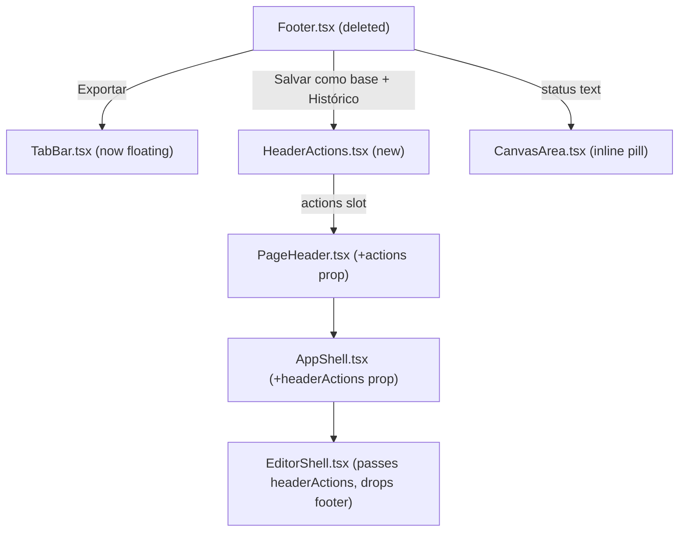

# Editor Chrome Restructuring Design

**Spec**: `.specs/features/redesign-editor/spec.md`
**Status**: Approved (approach A, see below — proceeding without a second confirmation round since the underlying restructuring was already approved by the user; this section documents the exploration for the record)

---

## Architecture Overview

Three chrome pieces move out of `Footer.tsx` (which is deleted) into three new homes, and one existing component (`TabBar`) changes from a flow row to a floating overlay:

**Approach exploration (Design phase requirement for Complex-tier features):**

| Approach                                                                           | Description                                                                                                                                                                                                                                                                    | Trade-off                                                                                                                                                                                                                                                                              |
| ---------------------------------------------------------------------------------- | ------------------------------------------------------------------------------------------------------------------------------------------------------------------------------------------------------------------------------------------------------------------------------ | -------------------------------------------------------------------------------------------------------------------------------------------------------------------------------------------------------------------------------------------------------------------------------------- |
| **A — Redistribute in place (chosen)**                                             | Extend the existing "CanvasArea composes floating pieces directly" pattern (already true of `FloatingToolbar`/`ZoomControls`) to `TabBar` and a new inline status pill; lift the two header-bound actions into a small new `HeaderActions.tsx` behind a new `PageHeader` slot. | Touches the most files (6), but every file's diff is a small, well-understood move — no new abstraction layer, matches how the screen already composes floating controls.                                                                                                              |
| B — New `EditorCanvasChrome` wrapper owning all floating overlays                  | One component renders `TabBar` + status pill + `FloatingToolbar` + `ZoomControls` as a cohesive unit.                                                                                                                                                                          | Cleaner-looking composition, but `CanvasArea` already owns this composition directly today (no existing wrapper to extend) — introducing one now is an abstraction with a single call site, which CLAUDE.md's "don't add abstractions beyond what's needed" argues against.            |
| C — Keep `Footer.tsx` as the component boundary, reposition via CSS (portal/fixed) | Smallest line diff.                                                                                                                                                                                                                                                            | Cross-boundary CSS positioning of a component whose JSX tree lives elsewhere (inside `AppShell`'s `footer` slot) to visually appear inside the header and canvas is fragile (z-index/stacking-context fights, breaks on any AppShell layout change) and not idiomatic React. Rejected. |

Approach A is the only one that keeps every piece owned by the component that already has the data it needs (`CanvasArea` already computes `conflict`/`isGenerating`/`pattern`; `TabBar` already renders per-tab chrome), so it's the recommendation and what's implemented.

---

## Code Reuse Analysis

### Existing Components to Leverage

| Component                                                                                        | Location                                                                                                                       | How to Use                                                                                                                                                                                                                                                                                                                    |
| ------------------------------------------------------------------------------------------------ | ------------------------------------------------------------------------------------------------------------------------------ | ----------------------------------------------------------------------------------------------------------------------------------------------------------------------------------------------------------------------------------------------------------------------------------------------------------------------------- |
| `Footer.tsx`'s save-as-base state machine (`savingBase`, `baseName`, `baseNotice`, `submitBase`) | `components/editor/Footer.tsx:31-55`                                                                                           | Moved near-verbatim into `HeaderActions.tsx` — same state shape, same `saveAsSloper` store call, same 6s auto-dismiss effect.                                                                                                                                                                                                 |
| `Footer.tsx`'s `exportDisabled`/`exportDisabledTitle`/`statusText` derivations                   | `components/editor/Footer.tsx:56-90`                                                                                           | Same derivations, relocated: `exportDisabled`/`exportDisabledTitle` computed in `CanvasArea` (which already has `pattern`/`conflict`/`isGenerating`) and passed to `TabBar`; `statusText` computed and rendered inline in `CanvasArea`.                                                                                       |
| `.float-chrome`-equivalent styling already in use                                                | `components/editor/FloatingToolbar.tsx:33`, `ZoomControls.tsx:18` (`bg-surface border-border rounded-item shadow-card border`) | `TabBar`'s new floating variant reuses the same token set, adding the translucency/blur the design specifies (`bg-surface/86 backdrop-blur-sm`), since `FloatingToolbar`/`ZoomControls` are opaque `bg-surface` while the design's tab bar is explicitly translucent (`rgba(255,255,255,.86)` over the pattern-grid texture). |
| `PageHeader`'s existing `(backHref \|\| title) && <Separator/>` divider pattern                  | `components/shared/PageHeader.tsx:74-76`                                                                                       | Same pattern reused for the new `actions && <Separator/>` divider before the action buttons.                                                                                                                                                                                                                                  |

### Integration Points

| System                      | Integration Method                                                                                                                                                                              |
| --------------------------- | ----------------------------------------------------------------------------------------------------------------------------------------------------------------------------------------------- |
| `AppShell`                  | Gains one new optional prop, `headerActions?: ReactNode`, threaded straight to `PageHeader`'s new `actions` prop — no other screen passes it, so every other `AppShell` consumer is unaffected. |
| `i18n` (`Footer` namespace) | Kept as-is (see spec's Out of Scope) — `HeaderActions.tsx`, `TabBar.tsx`, and `CanvasArea.tsx` all call `useTranslations("Footer")` for the specific keys they need, same keys, same values.    |

---

## Components

### `PageHeader.tsx` (modified)

- **Purpose**: Accept an optional `actions` slot rendered after the credits pill, before the account menu.
- **Location**: `components/shared/PageHeader.tsx`
- **Interface change**: adds `actions?: ReactNode` to its props; renders `{actions && <><Separator orientation="vertical" className="h-5" />{actions}</>}` between the credits block and the `DropdownMenu` trigger.
- **Dependencies**: none new.
- **Reuses**: the existing `Separator` divider pattern already used for the back-button divider.

### `AppShell.tsx` (modified)

- **Purpose**: Thread the new slot through without becoming a second place a screen can hand-roll header markup.
- **Location**: `components/shared/AppShell.tsx`
- **Interface change**: adds `headerActions?: ReactNode`, passed to `<PageHeader actions={headerActions} .../>`.
- **Dependencies**: none new.

### `HeaderActions.tsx` (new)

- **Purpose**: Render "Histórico" (link) + "Salvar como base" (button, dialog, notice) — everything Footer owned except Exportar and the status text.
- **Location**: `components/editor/HeaderActions.tsx`
- **Interfaces**: `HeaderActions({ pattern, conflictActive, generating }: { pattern: Pattern; conflictActive: boolean; generating: boolean })` — same prop shape `Footer` took, minus nothing (it needs the same three).
- **Dependencies**: `useEditorStore`'s `saveAsSloper`, `next/link`, `Dialog`/`Field`/`Input` primitives — identical imports to `Footer.tsx` today.
- **Reuses**: `Footer.tsx`'s save-as-base JSX/state almost verbatim; the save notice becomes a small `absolute top-full right-0 mt-2` anchored chip under the action group instead of an inline footer-row span (spec's Assumptions).

### `TabBar.tsx` (modified)

- **Purpose**: Same tab/size/details controls, now floating, plus the relocated Exportar button.
- **Location**: `components/editor/TabBar.tsx`
- **Interface change**: root `
` className changes from the static-row classes to `absolute inset-x-4 top-4 z-10 flex items-center gap-2 rounded-item border border-border bg-surface/86 py-[3px] px-1 shadow-card backdrop-blur-sm` (translucent floating chip, `Editor.dc.html:453`'s values mapped onto existing tokens); adds `exportHref: string | null` and `exportTitle?: string` props (mirrors `Footer`'s enabled/disabled Link-vs-Button branch).
- **Dependencies**: unchanged (`next/link` added for the Exportar link).
- **Reuses**: its own existing `TabsList`/`SizeSelector`/details-toggle JSX unchanged; only the wrapper and the new button are new.

### `CanvasArea.tsx` (modified)

- **Purpose**: Owns the floating chrome's containing block, the relocated status pill, and the `FloatingToolbar`/"Limpar medições" repositioning.
- **Location**: `components/editor/CanvasArea.tsx`
- **Changes**:
  - The `<Tabs>` root gains `relative` so `TabBar`'s new `absolute` positioning resolves against it (not the page).
  - `PatternCanvas`'s containing div's inset changes from `top-[22px]` to `top-[58px]` (spec EDCH-03).
  - A new inline status pill (`absolute bottom-4 left-4`, `.float-chrome`-equivalent classes, rounded-full per `Editor.dc.html:487`) renders `statusText`, derived exactly as `Footer.tsx` derived it (`copyCount`/`baseSize`/`unit`/conflict/generating branches) — computed inline, not extracted to a new file (single call site).
  - `exportDisabled`/`exportDisabledTitle` computed the same way (moved from `Footer.tsx`), passed into `TabBar`.
  - `FloatingToolbar` (and the measure-tool note, and "Limpar medições" when present) move from `top-5 left-5` / `bottom-5 left-5` to a single stacked column at `top-[54px] left-4` (spec's Assumptions — clears the floating tab bar's ~46px height + margin).
- **Reuses**: everything else in the file (seam graph memoization, graded overlays, tab content) is untouched.

### `EditorShell.tsx` (modified)

- **Purpose**: Stop rendering `Footer`; pass `HeaderActions` through the new `headerActions` prop.
- **Location**: `components/editor/EditorShell.tsx`
- **Changes**: removes the `footer={<Footer .../>}` prop and the `Footer` import; adds `headerActions={<HeaderActions pattern={pattern} conflictActive={conflict !== null} generating={generationStatus === "generating"} />}`.

### `Footer.tsx` / `Footer.test.tsx` (deleted)

Coverage redistributes to `HeaderActions.test.tsx` (new), `TabBar`'s existing test coverage (extended, now inline in `CanvasArea.test.tsx` since `TabBar` has no standalone test file today — matching that existing convention), and `CanvasArea.test.tsx` (extended for the status pill and layout inset).

---

## Data Models

None — no persisted shape changes. This is presentation-only; every value rendered already existed on `Pattern`/`ConflictInfo`/store state.

---

## Error Handling Strategy

| Error Scenario                          | Handling                                                                                   | User Impact                                                                                   |
| --------------------------------------- | ------------------------------------------------------------------------------------------ | --------------------------------------------------------------------------------------------- |
| `saveAsSloper` rejects                  | Unchanged from today: `baseNotice` shows the error tone/text                               | Same red/amber-toned chip, now anchored under the header buttons instead of in the footer row |
| Export disabled for any of the 3 causes | Unchanged gating, same title text, now on the floating button instead of the footer button | Identical message, new location                                                               |

---

## Risks & Concerns

| Concern                                                                                                                                                               | Location (file:line)                                         | Impact                                                                                                                              | Mitigation                                                                                                                                                                           |
| --------------------------------------------------------------------------------------------------------------------------------------------------------------------- | ------------------------------------------------------------ | ----------------------------------------------------------------------------------------------------------------------------------- | ------------------------------------------------------------------------------------------------------------------------------------------------------------------------------------ |
| `FloatingToolbar`/measure-tool/"Limpar medições" reposition has no design reference (spec Out of Scope)                                                               | `CanvasArea.tsx:193-220` (current)                           | A layout judgment call, not a cited value — could look cramped if the tab bar's real rendered height differs from the assumed ~46px | `top-[54px]` gives 8px of slack past the tab bar's `top-4` (16px) + `~32px` content height; verified visually against the dev build during Execute, not just assumed from arithmetic |
| Existing `CanvasArea.test.tsx`/`Footer.test.tsx`/`EditorShell.test.tsx` (826 lines combined) assert today's DOM structure (footer landmark, TabBar as a flow sibling) | `components/editor/{CanvasArea,Footer,EditorShell}.test.tsx` | A large, mechanical test-rewrite surface — easy to silently drop a behavioral assertion while moving it                             | Task-by-task: each task that relocates behavior also relocates (never deletes-and-forgets) its covering assertions in the same commit:                                               |
| `PageHeader.test.tsx`/`AppShell.test.tsx` assert the header's current children                                                                                        | `components/shared/{PageHeader,AppShell}.test.tsx`           | The new optional `actions` prop must not break any screen that doesn't pass it (i.e., every screen but the editor)                  | New prop is optional and additive; existing tests assert its _absence_ renders nothing extra — a dedicated new test covers its presence                                              |

---

## Tech Decisions (only non-obvious ones)

| Decision                                                            | Choice                                                                                                | Rationale                                                                                                                                                                                                                                                                                                                                                                        |
| ------------------------------------------------------------------- | ----------------------------------------------------------------------------------------------------- | -------------------------------------------------------------------------------------------------------------------------------------------------------------------------------------------------------------------------------------------------------------------------------------------------------------------------------------------------------------------------------- |
| Floating tab bar translucency                                       | `bg-surface/86 backdrop-blur-sm` (Tailwind opacity+blur utilities) rather than a new CSS custom class | Matches the design's literal `rgba(255,255,255,.86)` + `blur(6px)` using existing utility classes — `bg-surface` is `#ffffff`, so `/86` reproduces the exact alpha; `backdrop-blur-sm` (4px) is the closest stock Tailwind step to blur(6px) — close enough that a custom arbitrary `backdrop-blur-[6px]` isn't warranted for a 2px difference nothing will visually distinguish |
| Status pill and save notice are inline JSX, not new leaf components | Inline in `CanvasArea.tsx` / `HeaderActions.tsx`                                                      | Both have exactly one call site — CLAUDE.md's "don't add abstractions beyond what's needed"                                                                                                                                                                                                                                                                                      |

No new `AD-NNN` project-level decision — every choice here is feature-local (an optional `PageHeader` prop and a component split), not a new project-wide convention.

---

## Tasks Preview

9 ACs, expected ~9-11 atomic tasks (see `tasks.md`) — over the ~8-task inline-execution threshold, so the sub-agent delegation offer applies per `implement.md`.
