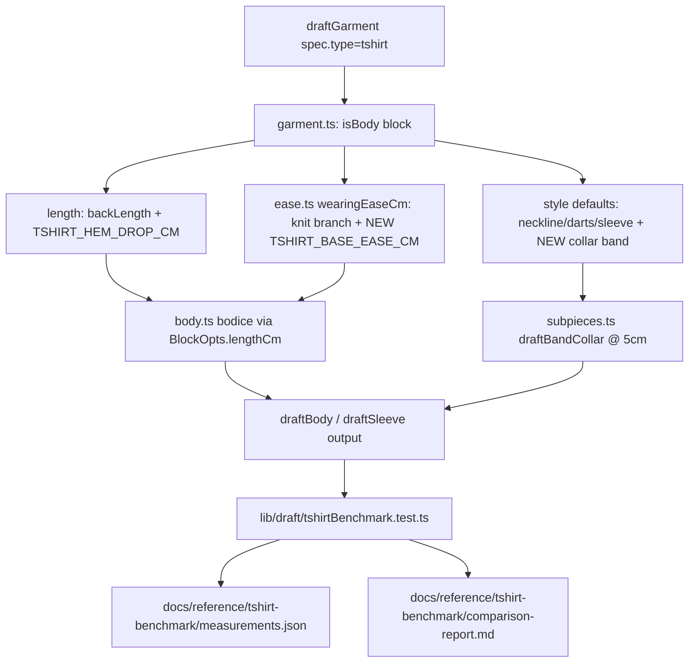

# T-Shirt Fit Calibration Design

**Spec**: `.specs/features/tshirt-fit-calibration/spec.md`
**Status**: In Progress

---

## Architecture Overview

Three approaches were considered for where the four formula/constant changes and the
comparison tool live.

**A — Inline, minimal-surface (recommended).** Each of the four changes lands as a small,
local edit in the file that already owns that concern: the length ternary in `garment.ts`
gains a third branch; `ease.ts`'s `wearingEaseCm` knit formula gets one new named constant
added to it; `garment.ts`'s existing tshirt-style-defaults block gains one more default;
`subpieces.ts`'s `BAND_COLLAR_HEIGHT_CM` changes from 4 to 5. The comparison tool is one new
test file. No new shared module, no new `GarmentStyle` field.

**B — Dedicated tshirt-config module.** Centralize every tshirt-specific constant (length
drop, base ease, collar default) in a new `lib/draft/tshirtDefaults.ts`, imported by
`garment.ts`. Gives future tshirt-specific tuning one home.

**C — Generalize the archetype-length formula.** Refactor the `blouse`/`dress`/`tshirt` length
ternary into a per-archetype config table before adding the tshirt branch.

**Recommendation: A.** This codebase's own convention (`CLAUDE.md`: "Don't add abstractions
beyond what's needed") and the spec's own AC8 ("SHALL NOT change any formula, constant, or
default for `blouse`, `dress`, `skirt`, or `trousers`") both push away from B and C — B adds a
module for exactly two constants (premature), and C touches the shared ternary's structure for
archetypes this feature has no reference data for, growing the diff and the regression surface
for no benefit this feature needs. A is the smallest change that satisfies every AC.



---

## Code Reuse Analysis

### Existing Components to Leverage

| Component                                           | Location               | How to Use                                                                                                                                                         |
| --------------------------------------------------- | ---------------------- | ------------------------------------------------------------------------------------------------------------------------------------------------------------------ |
| `SIZE_TABLE_MALE`                                   | `lib/measurements.ts`  | Base body-measurement chart for the comparison — see Data Models below.                                                                                            |
| `draftGarment`                                      | `lib/draft/garment.ts` | Drive the comparison tool's per-size drafts directly — no new drafting path.                                                                                       |
| `curveArcLengthCm`, piece `outlineCm`/`curvedSpans` | `lib/draft/core.ts`    | Compute a drafted piece's own perimeter/curve-split/area/bbox for the comparison — same primitives `easeReport.ts`/export already use, not a new geometry library. |
| `formatCm`                                          | `lib/format.ts`        | Render the comparison report's numbers consistently with the rest of the app.                                                                                      |
| `STRETCH_EASE_PCT`/`wearingEaseCm`                  | `lib/draft/ease.ts`    | Extend in place (add the new base-ease constant), not replaced.                                                                                                    |

### Integration Points

| System                                                                                         | Integration Method                                                                                                                                                                                                                                                                                                                 |
| ---------------------------------------------------------------------------------------------- | ---------------------------------------------------------------------------------------------------------------------------------------------------------------------------------------------------------------------------------------------------------------------------------------------------------------------------------- |
| `docs/reference/tshirt-benchmark/measurements.json`                                            | Read by the new test file at test-run time (static JSON import), never mutated.                                                                                                                                                                                                                                                    |
| Existing archetype tests (`garment.test.ts`, `body.test.ts`, `sleeve.test.ts`, `ease.test.ts`) | Any assertion hardcoding the OLD `BAND_COLLAR_HEIGHT_CM` (4) or the old tshirt length/ease/collar-default behavior must be updated in the same commit as the constant change (AC8's "existing tests continue to pass" means updated-and-passing for the tshirt-specific ones, unmodified-and-passing for every other archetype's). |

---

## Components

### `garment.ts` — length formula (TSHIRT-01)

- **Purpose**: Give `tshirt` its own length constant instead of reusing the blouse hip-length
  formula.
- **Location**: `lib/draft/garment.ts`, replacing the existing ternary at (current) lines
  306-309.
- **Interfaces**: no new exported function — the existing `lengthCm` local var's computation
  changes from a 2-way ternary to a 3-way one:
  ```ts
  const lengthCm =
    spec.type === "dress"
      ? measurements.backLength
      : spec.type === "tshirt"
        ? measurements.backLength + TSHIRT_HEM_DROP_CM
        : measurements.backLength + measurements.hipHeight + 5;
  ```
- **Dependencies**: new constant `TSHIRT_HEM_DROP_CM`, defined and cited in this same file
  (co-located with the other tshirt-specific style defaults it sits beside) or in `body.ts`
  alongside similar body-length constants — final placement decided in Tasks, whichever keeps
  the citation comment beside the constant it documents.
- **Reuses**: the existing `garmentLengthCm` plumbing (already threaded through to
  `TechSheetTab`/export) — no consumer of `garmentLengthCm` needs to change.

### `garment.ts` — tshirt style defaults (TSHIRT-03, TSHIRT-05)

- **Purpose**: Default `collar` to `"band"` for a `tshirt` spec that doesn't set one.
- **Location**: `lib/draft/garment.ts`'s existing tshirt style-defaults object (current lines
  ~314-322).
- **Interfaces**: one added key: `collar: spec.style.collar ?? "band"`.
- **Dependencies**: `COLLARS` already includes `"band"` (`garment.ts:79`) — no enum change.
- **Reuses**: the exact same `?? `-default idiom the block already uses for `neckline`/`sleeve`.

### `ease.ts` — positive base ease for knit tees (TSHIRT-02)

- **Purpose**: Let `wearingEaseCm`'s knit branch return a genuinely positive figure for a
  regular/relaxed-fit tee, replacing the hardcoded `0` base.
- **Location**: `lib/draft/ease.ts`.
- **Interfaces**:
  ```ts
  export const TSHIRT_BASE_EASE_CM = <value, see Data Models>; // cited/labelled in-code
  export function wearingEaseCm(style: GarmentStyle, knit: boolean, bustCm: number): number {
    return knit
      ? TSHIRT_BASE_EASE_CM - (bustCm * STRETCH_EASE_PCT[style.stretch ?? "none"]) / 100
      : FIT_EASE_CM[style.fit ?? "fitted"].bust;
  }
  ```
- **Dependencies**: none new. `knit` is `true` only for `spec.type === "tshirt"` today
  (confirmed: `garment.ts:305`, `const knit = spec.type === "tshirt"`) — so this branch has
  exactly one caller archetype, and changing it cannot regress `blouse`/`dress`/`skirt`/
  `trousers` (AC8), none of which ever pass `knit: true`.
- **Reuses**: `STRETCH_EASE_PCT`/`style.stretch` exactly as today — a tee requesting
  `stretch: "high"` still tightens relative to the new positive base, so the "how much negative
  ease the fabric tolerates" semantics `STRETCH_CLASSES` documents in `prompt.ts` stays
  accurate; this feature does not touch `STRETCH_CLASSES`, the AI schema, or the prompt text.

### `subpieces.ts` — band collar height (TSHIRT-04)

- **Purpose**: Correct `BAND_COLLAR_HEIGHT_CM` from 4cm to 5cm.
- **Location**: `lib/draft/subpieces.ts:321`.
- **Interfaces**: one constant value change, no signature change.
- **Dependencies/Reuses**: none — this is the one figure in the whole benchmark comparable
  independent of any body-measurement assumption (a flat authored constant on both sides).

### `lib/draft/tshirtBenchmark.test.ts` — comparison tool (TSHIRT-06, TSHIRT-07, TSHIRT-09)

- **Purpose**: Draft a `tshirt` at P/M/G/GG from the documented body-measurement basis (Data
  Models below), measure each drafted piece's perimeter/area/bbox/curve-split using the same
  geometry primitives the rest of the app uses, diff against
  `docs/reference/tshirt-benchmark/measurements.json`, and write a checked-in report.
- **Location**: `lib/draft/tshirtBenchmark.test.ts` (co-located with `garment.test.ts`/
  `body.test.ts` — same `lib/draft/*.test.ts` convention, runs under the existing `node` vitest
  project since it touches no DOM).
- **Interfaces**: no new exports needed outside the test file itself; internal helpers:
  - `measurePiece(piece: DraftedPiece): { perimeterCm, areaCm2, rectilinearPerimeterCm, curvePerimeterCm, widthCm, heightCm }` — built from `curveArcLengthCm`/`outlineCm`/`curvedSpans`, matching `measurements.json`'s own field shape exactly (see Data Models) so the diff is a plain per-field subtraction.
  - `writeComparisonReport(rows): void` — formats the diff table and writes
    `docs/reference/tshirt-benchmark/comparison-report.md` via Node's `fs`, mirroring how
    `scripts/cron-renew.ts` is the one other place this codebase writes a file from a
    non-request code path (a test, here, not a script — but the same "plain `fs` write, no new
    dependency" shape).
- **Dependencies**: `draftGarment`, `SIZE_TABLE_MALE`, the new derived-measurement constant
  (Data Models), the benchmark JSON (static import).
- **Test assertions (per the Execution Contract — a test must assert a spec-defined outcome,
  not just produce a report)**: the file exists after the run; it lists exactly 4 sizes × 4
  pieces (16 rows) each carrying all 6 metrics; each row's reported "ours" value matches what
  `measurePiece` independently computed (a structural/completeness assertion, since AC6/AC7 are
  about the report's existence and shape — there is deliberately no assertion that any delta is
  below a threshold, per the spec's explicit "no fixed gate" decision).

---

## Data Models

### Derived body-measurement basis (TSHIRT-01/02, the Assumptions-table decision)

No new `Measurements` value is invented wholesale. The derivation reuses `SIZE_TABLE_MALE.M`
(already a real, existing measurement set in this codebase, not a fabricated one) for every
field the benchmark cannot inform on its own — `shoulder`, `waist`, `hip`, `hipHeight`,
`shortSleeveLength`, `longSleeveLength`, `shoulderSlope` (absent, falls back to the existing
male default 4.5cm) — and solves the two NEW tshirt-specific constants
(`TSHIRT_HEM_DROP_CM`, `TSHIRT_BASE_EASE_CM`) directly against the benchmark's own size-M
geometry, keeping `bust = 100` (`SIZE_TABLE_MALE.M`) fixed rather than inventing an unverifiable
"true" body measurement:

```
TSHIRT_HEM_DROP_CM  solved from: heightCm(back, M) = (backLength + TSHIRT_HEM_DROP_CM) - shoulderSlope
                     58.007 = (44 + drop) - 4.5  →  drop ≈ 18.5cm

TSHIRT_BASE_EASE_CM solved from: widthCm(front/back avg, M) = 2 * (bust/4 + ease/4)
                     ≈77.96 = 2 * (25 + ease/4)  →  ease ≈ 56cm
```

**Flag per AC9: the solved `TSHIRT_BASE_EASE_CM` (~56cm total bust ease) is well outside the
citable "loose tee" range found during research (a hand-sewing-pattern convention of roughly
15-20cm of finished bust ease for a loose knit tee — see Research citations below).** Two
readings are both plausible and neither is verifiable from the data available:

1. The benchmark tee is a deliberately oversized/streetwear-fit garment (a real, common style
   choice, plausible given the source files' 2018-2022 dates), whose ease genuinely exceeds
   classic hand-drafting conventions.
2. `SIZE_TABLE_MALE.M`'s `bust = 100` doesn't match whatever chest size the benchmark's "M"
   actually targets (its own size label is not proof of matching circumference).

This is exactly the input-basis ambiguity the user already accepted when choosing to
back-derive rather than assume — **the exact solved value is a Tasks/Execute-time computation
(run against real code, not hand arithmetic), and Execute must label it in-code as an estimate
with this exact caveat (AC9)**, not present it as a verified industry figure the way
`FIT_EASE_CM`'s Aldrich-cited bands are.

**Research citations for the "loose tee" range** (Knowledge Verification Chain step 4, web
search — flagged uncertain per step 5, since neither directly measures an oversized/streetwear
cut):

- Sewing For A Living, "Sewing Ease: What It Is, How Much to Add, and Where": loose tees can
  carry roughly 15-20cm (6-8in) of added ease.
- The Shapes of Fabric, "Draft a Basic Bodice Block for Knit Fabrics": an "easy fitting" knit
  top block adds roughly 2cm ease; a close-fitting block uses negative ease.

### `measurements.json` metric shape (already committed, TSHIRT-06/07)

```typescript
interface BenchmarkPieceSize {
  perimeterCm: number;
  areaCm2: number;
  rectilinearPerimeterCm: number;
  curvePerimeterCm: number;
  widthCm: number;
  heightCm: number;
}
// docs/reference/tshirt-benchmark/measurements.json:
// { pieces: { back|front|sleeve|collarBand: { qty, sizes: { P|M|G|GG: BenchmarkPieceSize } } },
//   wholeGarmentTotals: { P|M|G|GG: { perimeterCm, areaCm2 } } }
```

`measurePiece`'s return type (Components above) is deliberately the same shape as
`BenchmarkPieceSize` so the comparison is a plain field-by-field subtraction, never a
re-mapping.

**Relationships**: `comparison-report.md` is generated FROM `measurements.json` + `draftGarment`
output; it is never hand-edited and is fully reproducible by re-running the test file.

---

## Error Handling Strategy

| Error Scenario                                                  | Handling                                                                                                                                                                                          | User Impact                                     |
| --------------------------------------------------------------- | ------------------------------------------------------------------------------------------------------------------------------------------------------------------------------------------------- | ----------------------------------------------- |
| `measurements.json` fails to parse / is missing a piece or size | The test throws at import/read time (a build-time/test-time failure, not a runtime path any real user request reaches) — this file is dev-only reference data, never shipped to the drafting API. | None (no production code path reads this file). |
| The report write fails (e.g. read-only filesystem in CI)        | The test fails loudly (no silent skip) — matches this codebase's "never silently no-op" convention (CLAUDE.md).                                                                                   | None (dev/CI-only).                             |

> No user-facing error paths — every change in this feature is either a compile-time constant
> or a dev-only test/report, never a request-time failure mode.

---

## Risks & Concerns

| Concern                                                                                                                                                                               | Location (file:line)                                                                           | Impact                                                                                                                                                                               | Mitigation                                                                                                                                                                                                                                                                                                  |
| ------------------------------------------------------------------------------------------------------------------------------------------------------------------------------------- | ---------------------------------------------------------------------------------------------- | ------------------------------------------------------------------------------------------------------------------------------------------------------------------------------------ | ----------------------------------------------------------------------------------------------------------------------------------------------------------------------------------------------------------------------------------------------------------------------------------------------------------- |
| `TSHIRT_BASE_EASE_CM`'s solved value may land far outside any citable convention (see Data Models)                                                                                    | `lib/draft/ease.ts` (new constant)                                                             | A reviewer could mistake a large estimated figure for a verified one, the exact failure mode `.specs/STATE.md`'s AD-001 already warns about.                                         | AC9 requires the in-code comment to label it an estimate with the oversized-fit-vs-mismatched-input caveat spelled out (Data Models above) — enforced structurally, not left to reviewer memory.                                                                                                            |
| Changing `BAND_COLLAR_HEIGHT_CM` and the tshirt collar default will break any existing test that hardcodes the old 4cm height or asserts "no collar piece" for a default tshirt draft | `garment.test.ts`, `subpieces.ts`'s own tests (exact files TBD in Tasks — grep sweep required) | A stale test would either fail loudly (good — caught) or, worse, could have been asserting the WRONG old behavior as if it were correct, masking the very defect this feature fixes. | A Tasks-phase task greps every `BAND_COLLAR_HEIGHT_CM`/`4` and default-tshirt-collar assertion before editing, updates each deliberately (never blanket-replaces), and the Verifier's discrimination sensor (mutating the new constants back) will catch any test that doesn't actually pin the new values. |
| The comparison report could go stale (formulas change later without re-running the test)                                                                                              | `lib/draft/tshirtBenchmark.test.ts`                                                            | A future contributor trusts a report that no longer reflects the code.                                                                                                               | The test asserts the report's structural completeness every run (`npm test` regenerates it as a side effect of a passing test, not a manually-maintained doc) — staleness self-corrects on the next full test run, and CI running `npm test` means it can't silently drift across a merged PR.              |

---

## Tech Decisions

| Decision                                                                  | Choice                                                                                              | Rationale                                                                                                                                                                                                                                                                                                                    |
| ------------------------------------------------------------------------- | --------------------------------------------------------------------------------------------------- | ---------------------------------------------------------------------------------------------------------------------------------------------------------------------------------------------------------------------------------------------------------------------------------------------------------------------------- |
| Where the comparison lives                                                | A vitest test file under `lib/draft/`, not a standalone script                                      | Matches AC6's "a vitest test or script," runs under the existing `npm test`/CI path (visible, re-run automatically) rather than a script someone has to remember to invoke by hand — and this codebase's `lib/draft/*.test.ts` convention is the natural home for a drafting-output check.                                   |
| Report file is regenerated (overwritten) on every run, never appended     | Plain overwrite via `fs.writeFileSync`                                                              | Spec's own Edge Cases section requires this explicitly (never two contradictory delta sets for the same constants).                                                                                                                                                                                                          |
| Keep `bust = SIZE_TABLE_MALE.M.bust` fixed rather than solving for it too | Solve only the two NEW constants (`TSHIRT_HEM_DROP_CM`/`TSHIRT_BASE_EASE_CM`), not every body field | Solving for an unverifiable "true" bust value would be fabricating precision this data can't support — pinning bust to an existing, already-used real number and being honest that the resulting ease estimate is large is more defensible than inventing a second unverifiable number to make the ease figure look smaller. |
